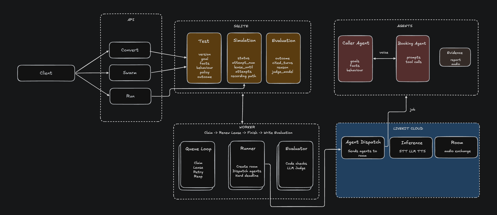

# Sawt Sims

A simulations product for voice agents: turn a reported failure into a repeatable test, stress the agent with a generated swarm of callers, and know whether a change can be trusted.

**Demo:** [5-minute Loom walkthrough](https://www.loom.com/share/6dc836f423694f8dba4732f59ca1f770)

**Use case:** a restaurant booking agent. **Reported failure:** v1 books without confirming the details; v2 fixes it.

## How to start

```bash
cp .env.example .env               # add your LiveKit Cloud keys
uv sync && (cd frontend && npm install && npm run build)
uv run sims web --start-agents      # website + agents → http://localhost:8000
uv run sims worker --max-calls 2    # run in two terminals
```

## How it works



| Term | What it is |
|---|---|
| **Agent version** | The agent under test (v1, v2): the same restaurant agent with a different prompt |
| **Digital human** | A second voice agent that plays the caller |
| **Test** | A scenario for the digital human (goal, facts, behavior) plus what the judge checks (policy under test, expected outcome). Versioned: an edit creates a new version |
| **Regression test** | A test made from a reported failure; guards a known bug |
| **Swarm** | A set of generated tests, one per rule, for an agent with no reported failure |
| **Simulation** | One voice call: one test against one agent version |
| **Attempt** | One try at a simulation; system errors are retried as new attempts on the same simulation |
| **Verdict** | The graded outcome of a simulation: Pass, Fail, Inconclusive or Execution Failure |
| **Worker** | A process that takes simulations from the queue and runs them |

```
Reviewer ─▶ Website ─▶ Test ─▶ queue ─▶ Worker ─▶ LiveKit room ─▶ evidence ─▶ checks + judge ─▶ Verdict
                                                  agent ⇄ digital human   (audio, transcript, tool calls)
```

1. The reviewer creates a test (from a failed call or a swarm) and starts it on one or more agent versions.
2. Each run becomes a simulation in the queue.
3. A worker places the call: the agent and the digital human talk by voice in a LiveKit room.
4. The agent saves the evidence: recording, transcript and tool calls.
5. Code checks the call happened properly; a judge then grades it against the test's policy.
6. The verdict appears in Results and the Dashboard, linked to the test version, agent version and evidence.

## Conversion: from a failed call to a regression test

- **What does the reviewer do?** Paste a transcript. The model drafts the test: the caller's goal, facts and behavior, plus the policy under test and the expected outcome. Each field is marked *Inferred* until the reviewer edits it. Nothing is saved until they confirm.
- **Is it a replay?** No. The caller is a live agent that recreates the *situation* (same goal, same facts, same trigger) and reacts to whatever the agent says. A replay would pass any agent.
- **How specific is a test?** The reviewer decides by editing facts and behavior: tight to pin one regression, loose to explore variants. We default to tight, because too much variance makes two versions hard to compare.
- **Does the caller know what's tested?** No. Caller fields describe only what a real caller wants and does; the policy and expected outcome go to the judge only.
- **What happens when a test is edited?** A new version is created. Earlier results stay attached to the version that actually ran, so a rerun never rewrites history.
- **What if the transcript shows no failure?** The model says so and drafts nothing, instead of inventing a bug.

## Evaluation: telling agent failures from system failures

- **What outcomes exist?** Four:

  | Outcome | Meaning | Counts against the agent? |
  |---|---|---|
  | **Pass** | The agent followed the policy | – |
  | **Fail** | The agent broke the policy | Yes |
  | **Inconclusive** | The situation never came up, or the judge couldn't decide | No |
  | **Execution Failure** | The call itself broke: no audio, no report, someone never spoke, timeout | No |

- **How are system failures kept out of verdicts?** Code checks the call before any judge sees it: did it finish, is there a recording and a session report, did both sides speak? If not, it's an Execution Failure, and the agent is never blamed.
- **Why should I trust a Pass?** The judge must cite the turns that prove it (clickable in the UI), and code checks those turns exist. Missing evidence or a broken judge reply becomes Inconclusive, never a Pass.
- **What does the judge grade?** Only the test's one policy. Other rules have their own tests.
- **Is a completed call a passed call?** No. Completion only lets the call be graded.
- **Do pass rates mix things up?** No. Pass rate is pass ÷ (pass + fail); Inconclusive and Execution Failures are shown separately. Every verdict records its judge model and prompt version, and comparisons use one judge.
- **Comparing v1 and v2:** each test shows Passing, Flaky or Failing per version, and flags too few runs to rely on.

## Swarm: testing a new agent without a reported failure

- **Where do tests come from?** From the restaurant's rules and knowledge base, never from the prompt under test, so a buggy prompt can't produce tests that expect its bug.
- **What does the reviewer control?** They see the rules found, tick which to cover, and review every generated test before running. One test per rule, so a failure points to one rule.
- **Are swarm and regression tests mixed?** No. Regression tests guard known failures; swarm tests explore. Results and dashboards show one at a time, so exploratory noise never dilutes the trusted numbers.
- **What if a swarm test finds something real?** Promote it: it becomes a permanent regression test that remembers which swarm it came from, and its swarm runs count as evidence.
- **Can I follow a big run?** Each press of Run is numbered, with its own progress bar, one pill per simulation, and Cancel.

## Reliability: every simulation accounted for

- **Can a simulation be lost or counted twice?** No. Each requested simulation is one row. A retry is the next *attempt* on the same row, so totals always add up.
- **What is retried?** System errors only (a failed call, a missing recording), up to 3 attempts. A real Pass, Fail or Inconclusive is never retried, so a flaky agent can't be retried into a pass. Each attempt keeps its own evidence, so an earlier failure stays visible after a later success.
- **What if a worker dies mid-call?** It holds each simulation under a 60-second lease. When the lease runs out, another worker marks the attempt Interrupted and puts it back in the queue.
- **What if a call hangs?** A hard deadline around every attempt stops it, so nothing stays Running forever.
- **What if too much is started?** A start that doesn't fit the queue is refused whole, and recorded, so there are no half-started swarms and refused work still counts.
- **How many run at once?** A global cap (4 on this laptop) keeps within machine and account limits.
- **Can I see it?** System health shows queue and workers live, and a ledger where every requested simulation sits in one bucket: Finished, In Flight, Execution Failure, Not Graded, Cancelled or Refused. In demo mode you can kill a worker or inject failures from the page and watch recovery.

## Benchmarks

| Area | Measures | Result |
|---|---|---|
| [Conversion](benchmark/conversion/results.md) | Test keeps the failure's goal, facts, trigger and policy | 19/24 checks |
| [Evaluation](benchmark/evaluator/README.md) | Verdicts match hand labels; a Pass is safe to rely on | 96% accuracy, 86% pass precision |
| [Swarm](benchmark/swarm/README.md) | Every rule gets a test; tests catch a broken agent | 8/8 covered, 4/8 bugs caught |
| [Reliability](docs/RELIABILITY.md) | Every simulation finishes exactly once under spike, failures and a crash | 32/32, recovery in 63 s |

## Limitations

- Single machine; capacity is limited by laptop memory, not the design.
- One test per rule, so each rule is tested from one angle.
- No human override of a verdict.
- Left out on purpose: auth, multiple tenants, Kubernetes. Task 4 not attempted.
